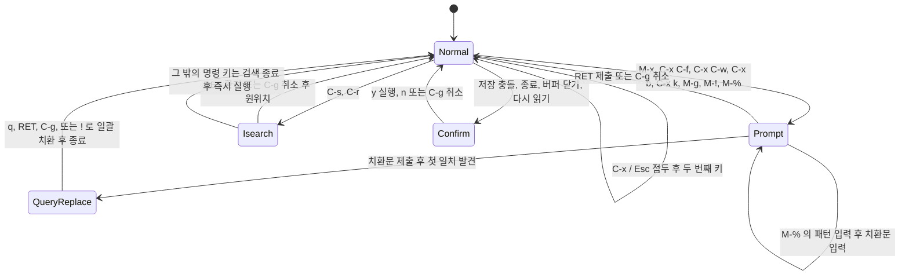
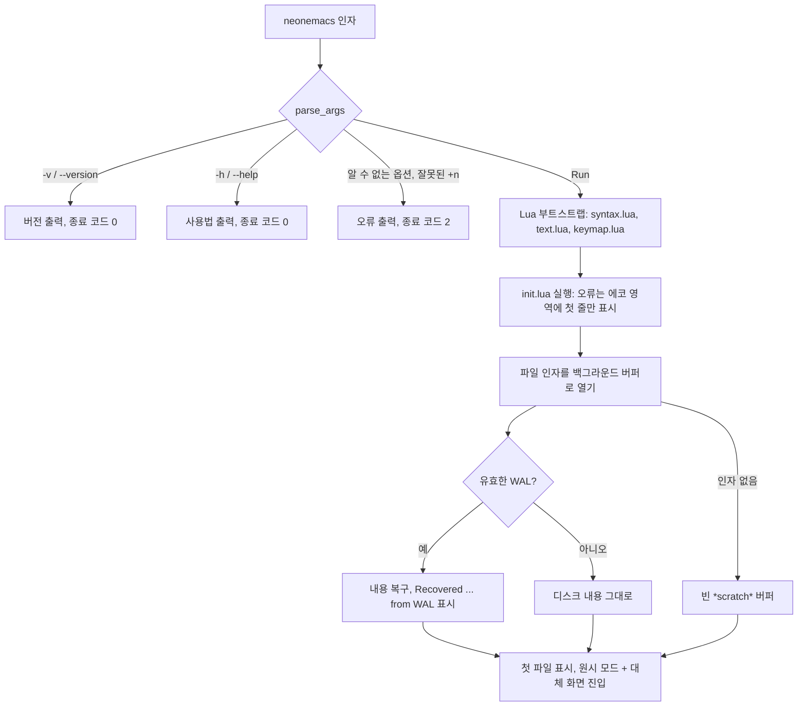
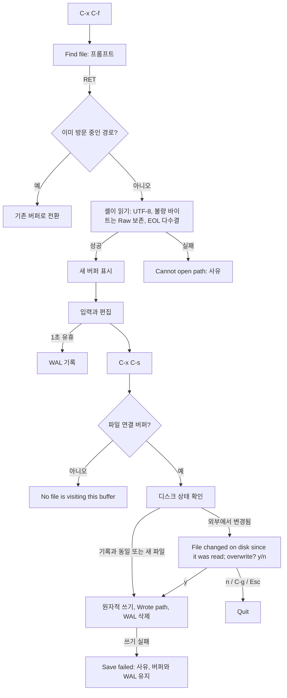
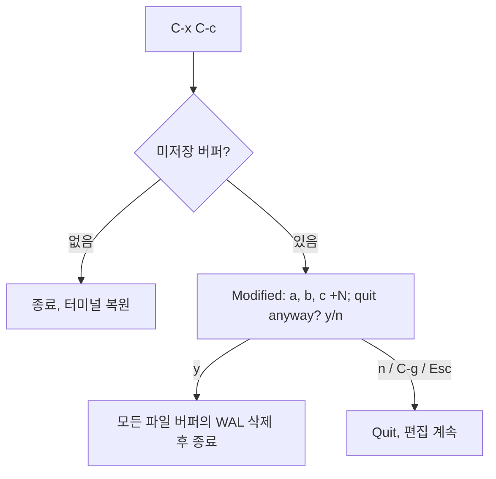
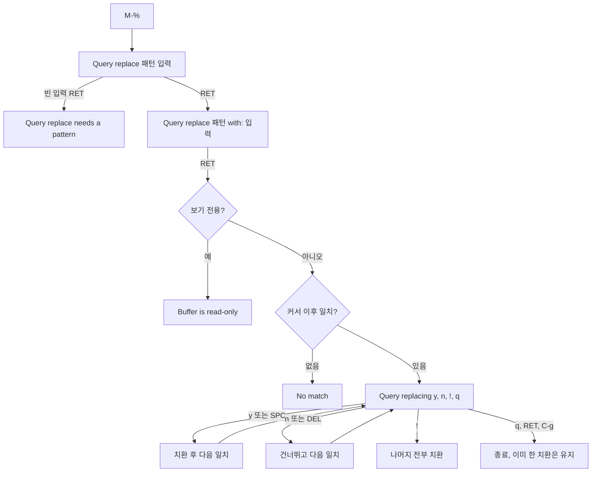
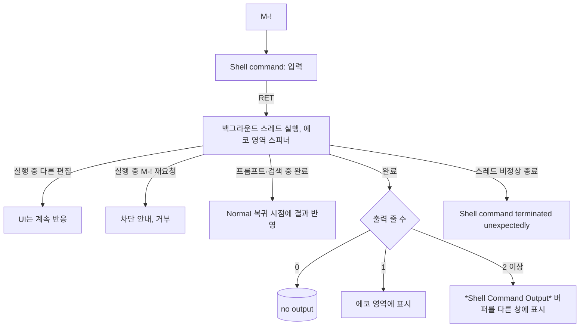
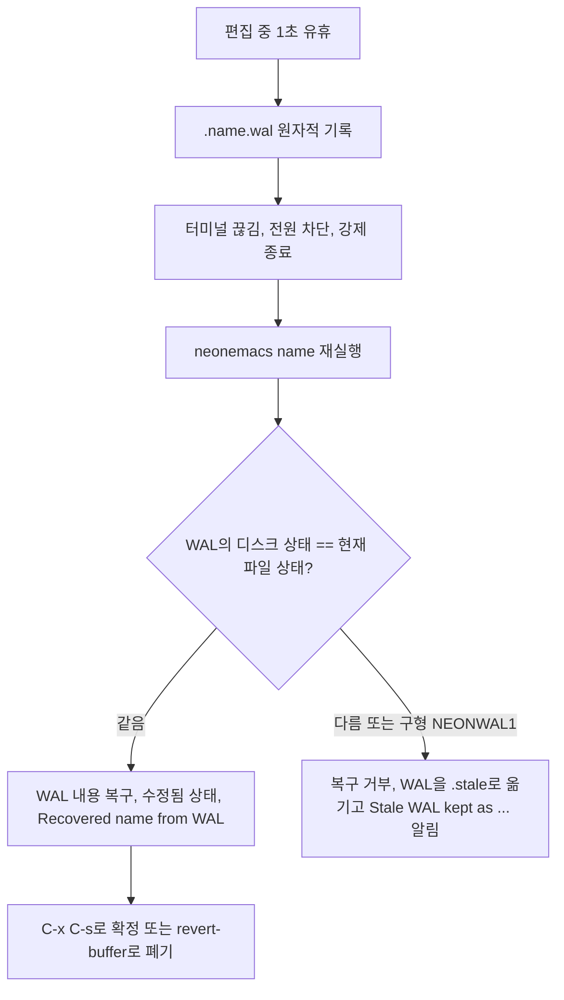

# neonemacs 유저 플로우

> 독자: 사용자, 구현자, 테스트 작성자
>
> 근거: `docs/spec.md`, `docs/adr/`, `src/` (키 처리: `core/dispatch.rs`, `core/commands/`, 시작: `shell/startup/`, 이벤트 루프: `shell/session/`).
> 이 문서는 코드에서 읽어 낸 흐름이다. 명세와 충돌하면 `docs/spec.md`가 우선한다.

## 1. 페르소나와 대표 시나리오

| 페르소나 | 목표 | 주 플로우 |
| --- | --- | --- |
| 터미널 사용자 (Emacs 경험자) | SSH·서버에서 설정 파일 빠르게 수정 | F1, F2, F3 |
| 한글 문서 작성자 | UTF-8/한글 텍스트를 손실 없이 편집 | F2, F6 |
| 개발자 | 코드 편집, 검색·치환, 셸 명령 확인 | F4, F5, F7 |
| 파워 유저 | Lua로 키·명령·구문 강조 확장 | F9 |
| 사고 직후 사용자 | 비정상 종료 후 편집 내용 복구 | F8 |

## 2. 모드 상태 기계

모든 입력은 현재 `Mode`가 해석한다 (`core/dispatch.rs::handle_key`).

- Confirm에서 `y`, `n`, `C-g` 외의 키는 무시되고 질문이 유지된다.
- `C-g`는 Normal에서 접두 상태를 풀고 `Quit`을 표시한다.
- 정의되지 않은 키 조합은 `<키> is undefined`를 표시하고 아무것도 바꾸지 않는다.

## 3. 플로우

### F1. 실행과 시작

예측 포인트:

- `neonemacs a.txt +20 b.txt`: `a.txt`가 화면에 뜨고 `b.txt`는 20번째 줄에 커서를 둔 채 백그라운드에 있다. `C-x b`로 전환한다.
- `neonemacs a.txt ./a.txt`는 버퍼 하나이며 WAL 복구도 한 번만 일어난다.
- 존재하지 않는 경로는 빈 버퍼로 열리고 첫 저장 시 묻지 않는다.
- `max-file-size` 초과 파일은 `File too large: N bytes (max-file-size M)`만 띄우고 버퍼를 만들지 않는다. 첫 인자가 모두 거부되면 `*scratch*`로 시작한다.
- `init.lua` 오류가 있어도 편집기는 뜨며 `init.lua: <첫 줄>`이 보인다.

### F2. 파일 열기, 편집, 저장 (핵심 경로)

예측 포인트:

- `*scratch*`나 `switch-to-buffer`로 만든 버퍼에서 `C-x C-s`를 누르면 저장되지 않고 안내만 나온다. 이름을 정하려면 `C-x C-w`(`write-file`)를 쓴다.
- 저장 사고 방지는 "묻기"와 "WAL" 두 겹이다. 사용자가 저장하지 않아도 편집은 1초 후 `.<이름>.wal`에 남는다.

### F3. 종료

- `y`는 변경을 버린다. WAL도 삭제되므로 이후 복구 경로가 없다.
- 확인 대상은 현재 버퍼가 아니라 모든 버퍼다. 질문에 수정된 버퍼 이름이 앞에서 3개까지 나온다(나머지는 `+N`).
- `y`/`n`은 대문자와 한글 자모 `ㅛ`/`ㅜ`도 받고, 다른 키는 질문을 반복한다 (I-46).
- 수정된 `*scratch*`도 질문에 나온다. `y`는 scratch 슬롯도 지운다 (I-43).

### F4. 검색과 치환

증분 검색 (`C-s`, `C-r`, `M-x isearch-forward-regexp` 등):

1. 모드가 `Isearch`로 바뀌고 에코 영역에 `I-search:`가 뜬다.
2. 글자를 입력할 때마다 일치 위치로 커서가 이동한다. 실패하면 `Failing I-search: ...`.
3. `C-s`/`C-r`은 다음/이전 일치로 이동하고 끝에서 `Wrapped`로 되돌아간다.
4. Backspace는 시작 지점부터 다시 검색한다.
5. `RET`은 현재 위치에서 종료한다. `C-g`는 시작 지점으로 돌아간다. 그 밖의 이동·편집 키는 검색을 끝내고 그 키를 바로 실행한다.
6. 잘못된 정규식은 `Invalid regexp: ...`를 표시하고 실패 상태로 둔다.

치환 (`M-%`, `M-x query-replace-regexp`):

- 치환 세션 전체가 undo 한 단위다. `C-/` 한 번이면 전부 되돌아간다.
- 치환은 커서 위치 이후만 대상으로 한다. 버퍼 전체를 바꾸려면 먼저 `M-<`로 처음으로 이동한 뒤 시작한다.

### F5. 다중 버퍼와 창

| 의도 | 흐름 |
| --- | --- |
| 다른 파일 보기 | `C-x b` → 이름 입력, TAB으로 완성 → RET. 없는 이름이면 빈 버퍼가 새로 생긴다. |
| 파일 닫기 | `C-x k` → 이름(빈 입력은 현재 버퍼) → 미저장이면 `Buffer is modified; kill anyway? (y or n)` |
| 마지막 버퍼 닫기 | 빈 `*scratch*`가 자동 생성되어 편집기는 항상 버퍼를 가진다. |
| 화면 분할 | `C-x 2`(위아래), `C-x 3`(좌우), `C-x o`(다음 창), `C-x 1`(나머지 닫기) |
| 같은 파일 두 곳에서 보기 | 분할 후 각 창이 독립적인 커서·스크롤을 가진다. |

- 버퍼를 전환했다 돌아오면 그 버퍼의 커서 위치가 복원된다.
- 버퍼를 닫으면 그 버퍼의 WAL도 함께 삭제된다. 미저장 닫기에서 `y`는 변경 폐기다.

### F6. 편집 (잘라내기, 복사, 되돌리기, 한글)

- 영역 지정: 기본 키가 없다. `M-x set-mark-command`를 실행하거나 `init.lua`에서 `bind`로 연결해야 한다. `C-x h`는 전체 선택이다.
- 잘라내기/복사/붙여넣기: `C-w`, `M-w`, `C-y`. 연속 `C-k`는 하나의 킬 항목으로 병합되고, `C-y` 직후 `M-y`가 순환한다. 그 사이에 편집이 끼면 `Previous command was not a yank`.
- 되돌리기: `C-/` 또는 `C-_`. 별도 redo가 없다. 다른 명령을 끼운 뒤 다시 undo하면 앞 상태로 돌아간다. 키 없이 `C-x u`도 같다.
- 연속 글자 입력은 최대 20자가 한 undo 단위다.
- 한글: 커서는 문자 경계로만 움직이고 전각 폭(2칸)이 상태 줄 열과 에코 영역 커서에 반영된다. IME 조합 표시는 터미널 몫이다.
- 보기 전용(`C-x C-q`): 편집, `toggle-eol`, `query-replace`가 거부되고 `Buffer is read-only`가 표시된다. 같은 키로 해제한다.
- 줄 끝 변환: `M-x toggle-eol`은 undo 가능하고 미저장 상태가 된다.

### F7. 셸 명령 (`M-!`)

- 출력 버퍼는 다음 실행 때 내용이 교체되고 그 버퍼의 undo는 초기화된다.
- 창이 하나뿐이면 자동으로 위아래 분할되며, 선택된 창은 원래 창에 남는다.

### F8. 비정상 종료 후 복구

- 복구는 파일을 여는 모든 경로에서 일어난다. 시작 인자든 `C-x C-f`든 같다 (I-45).
- `*scratch*`의 미저장 텍스트도 슬롯(`scratch.wal`)에서 복구된다. 크래시 뒤 다시 실행하면 `[Recovered *scratch* from WAL]` (I-42).
- 복구된 버퍼는 undo 기록이 비어 있어 복구 직후 `C-/`는 `No further undo information`을 표시한다.
- 그 사이 외부에서 파일이 바뀌었다면 WAL은 지워지지 않고 `.<이름>.wal.stale`로 옮겨지며 `Stale WAL kept as ...`가 보인다 (I-44). `.stale`은 사용자가 직접 지운다.
- WAL 쓰기에 실패하면 `WAL write failed: ...`를 띄우고 1초 뒤 재시도한다.
- `revert-buffer`: 미저장이면 `Discard changes and revert? (y or n)`. 성공하면 WAL이 삭제된다. 파일이 사라졌으면 `Revert failed: path does not exist`이며 버퍼와 WAL이 유지된다.

### F9. Lua 확장

1. `~/.config/neonemacs/init.lua`(또는 `$XDG_CONFIG_HOME`)를 만든다. 번들 스크립트 이후에 실행되므로 번들 키·명령을 덮어쓸 수 있다.
2. `bind("C-c C-c", ...)` 같은 시퀀스는 허용되지 않는다. 단일 키 또는 `C-x` 두 키만 가능하며 위반 시 시작 시 `init.lua:` 오류가 보인다.
3. `command("name", fn)`으로 등록한 명령은 즉시 `M-x`에서 TAB 완성 목록에 키 표시와 함께 나타난다. 내장 명령 이름은 재정의할 수 없다.
4. `set("tab-width", 4)` 등은 범위·타입이 검증된다. `syntax.register`로 새 언어 강조를 추가한다.
5. Lua 명령이 오류를 내면 첫 줄만 에코 영역에 표시되고 편집기는 계속 동작한다. `run`의 재귀 깊이는 50이다.

### F10. 명령 탐색 (`M-x`)

- `M-x` 입력 중 TAB: 후보가 하나면 자동 완성, 여럿이면 공통 접두사까지 채우고 `이름 (키)` 목록을 에코 영역에 보여 준다. 없으면 `No match`.
- 이 목록이 사실상 내장 도움말이다. 별도 `describe-key`나 도움말 명령은 없다.
- 프롬프트 편집은 `C-a`, `C-e`, `C-b`, `C-f`, `C-d`, Backspace, 방향키를 지원한다.

## 4. 오류·예외 경로 요약

| 상황 | 사용자에게 보이는 것 | 상태 변화 |
| --- | --- | --- |
| 알 수 없는 CLI 옵션 / 잘못된 `+n` | stderr 메시지, 종료 코드 2 | 편집기 시작 안 함 |
| 런타임 치명 오류 | stderr 메시지, 종료 코드 1 | 터미널 복원 |
| 정의되지 않은 키 | `<키> is undefined` | 없음 |
| 읽기 실패 | `Cannot open path: 사유` | 버퍼 미생성 |
| 대용량 파일 | `File too large: ...` | 버퍼 미생성, 다시 읽기는 기존 버퍼 유지 |
| 저장 중 외부 변경 | `File changed on disk ... overwrite? (y or n)` | 답변 전 쓰기 없음 |
| 다른 이름 저장 시 기존 파일 | `File path exists; overwrite? (y or n)` | `n`이면 쓰기 없음 |
| 다른 버퍼가 방문 중인 경로로 저장 | `Buffer X is visiting path` | 거부, 상태 불변 |
| 저장 실패 | `Save failed: 사유` | 이름·경로·WAL 불변 |
| 숫자가 아닌 줄 번호 | `Not a line number: 입력` | 커서 불변 |
| 없는 버퍼 닫기 | `No buffer named X` | 불변 |

## 5. 초보자가 막히기 쉬운 지점

코드에서 확인되는 마찰이다. 해소된 항목은 해소 방법을 적었다. 제품 결정이 필요한 항목은 별도 ADR로 다룬다.

| # | 마찰 | 상태 |
| --- | --- | --- |
| 1 | 영역 선택 키가 없다 (`C-SPC` 제외). 해결 경로는 `M-x set-mark-command` 또는 `bind`뿐이다 | 열림. 대신 활성 영역이 반전 표시되어 상태가 보인다 (I-47) |
| 2 | 도움말 키가 없다. `M-x` TAB 목록이 유일한 탐색 수단이다 | 열림 |
| 3 | 종료 확인의 `y`가 WAL까지 지운다 | 부분 해소. 질문에 수정된 버퍼 이름이 나온다. `y`는 여전히 명시적 폐기다 |
| 4 | WAL 복구가 CLI 인자로 연 파일에만 적용된다 | 해소 (I-45) |
| 5 | 복구 거부가 무음이다 | 해소. `.stale`로 보존하고 알린다 (I-44) |
| 6 | `Esc`가 취소가 아니라 `M-` 접두다 | 부분 해소. 질문·프롬프트·검색·치환에서는 취소다. Normal 모드는 `M-` 접두 그대로다 |
| 7 | `M-f`, `M-v`, `C-v`, `C-SPC`를 기본 제공하지 않는다 | 열림 (터미널·입력기 충돌) |
| 8 | `query-replace`가 커서 이후만 검색한다 | 부분 해소. 시작 메시지가 `from point`를 밝힌다 |
| 9 | 파일 없는 버퍼에서 `C-x C-s`가 이름을 묻지 않고 거부한다 | 열림. 단 `*scratch*`는 슬롯으로 보호된다 (I-42). 다른 이름의 무파일 버퍼는 보호되지 않는다 |
| 10 | 저장 후 입력을 undo해도 `**`가 남는다 | 해소 (I-41) |
| 11 | 질문에서 잘못된 키(한글 입력 상태의 `y` 포함)가 무반응이다 | 해소 (I-46) |

## 6. 검증 상태

- 이 문서는 정적 코드 읽기로 작성했고, 5절의 해소 상태는 구현 뒤 `cargo test`로 확인했다. 실제 터미널 실행으로는 확인하지 않았다 (Unverified).
- 확인한 소스: `docs/spec.md`, `docs/adr/README.md`, `src/main.rs`, `src/core/{dispatch,mode,keymap,render,buffer,undo,file,effect}.rs`, `src/core/commands/{prompt,file,search,buffer_window,shell_output,table,edit,motion}.rs`, `src/shell/startup/*`, `src/shell/session/*`, `src/shell/wal.rs`, `src/shell/keymap.lua`.
- 읽지 않은 부분: `text.lua` 동작 세부. F6의 일부 서술은 명세에 근거한다.
